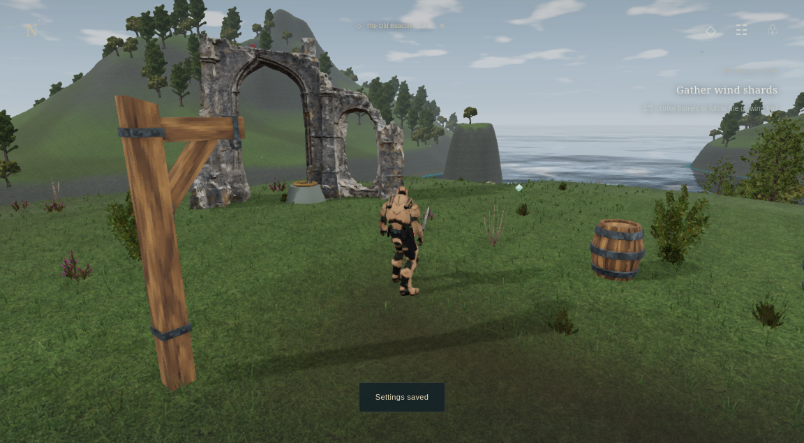

# Northreach IV — The Broken Oath

[**Download the game — self-contained HTML in a ZIP (24 MB)**](https://github.com/BarbaraCodingOS/game/raw/refs/heads/playtest/northreach-v4-download/Northreach-PLAY.zip?download=1)

Extract **Northreach-PLAY.zip**, then open **Northreach-PLAY.html** in a recent
desktop browser. Choose **Begin a journey**. That one HTML file includes all game
code, textures and models. No companion game files, server or Internet connection
is needed. JavaScript and WebGL are required. Credits/test reports are included.

[Single HTML directly (39 MB)](https://github.com/BarbaraCodingOS/game/raw/refs/heads/playtest/northreach-v4-download/Northreach-PLAY.html?download=1): GitHub serves this as text. Use **Save link as** or GitHub’s **Download raw file** button to save it.

[Download the whole game as a ZIP (24 MB)](https://github.com/BarbaraCodingOS/game/raw/refs/heads/playtest/northreach-v4-download/Northreach-v4.zip)

For the ZIP, extract the whole folder, then open **Northreach-v4/START-GAME.html**.
Keep **game.js** and **game.css** beside it. Download the complete HTML above if you
prefer a single file. GitHub's Download raw file button is another download route.

V4 includes 47 imported environmental models/modules, oak/alder forests, smaller
wind-bent grass, textured terrain, coastal water, scalable lighting, modular
village/ruins/harbour, five working story chapters, a ferry, combat and a boss,
loot, checkpoints, saving, a new menu and adjustable graphics/controls.

WASD moves, drag looks, Shift runs, Space jumps/glides, Q dodges, F/left click
attacks, G is heavy attack, B/right click blocks, E interacts, C heals. M opens
the map, J the journal, I inventory and P/Esc pauses. Settings offer four presets;
choose Low/Medium if performance is poor. Saves belong to this browser and path.

**Validation:** 24 model tests and all 13 distinct browser cases passed across
full/targeted runs. Both downloadable formats passed actual file-URL playtests
with no HTTP/HTTPS runtime requests. See [validation](docs/validation.md).

**Limits:** The six Lost Warrior uploads exceeded the transfer tool's 32 MiB
per-file cap, so the existing character remains. Supplied pixel-fantasy art stays
visible; this is a browser-scale adventure. The cloud software renderer measured
about 1.24 FPS; this does not establish playable performance or 60 FPS on your
Mac. Last sampled game update was 0.9 ms. See the [performance report](docs/performance.json)
and [implementation notes](docs/implementation.md) for methods and limitations.

[Asset provenance](ASSET-CREDITS.txt) and original kit licenses are included.
Some individual user assets explicitly retain pending-clearance metadata; no
blanket CC0 claim is made. Models are embedded in the game, not offered as an
asset pack. [Download SHA-256 hashes](DOWNLOAD-CHECKSUMS.json).

Actual local-file test frame, High settings, software-rendered cloud:

