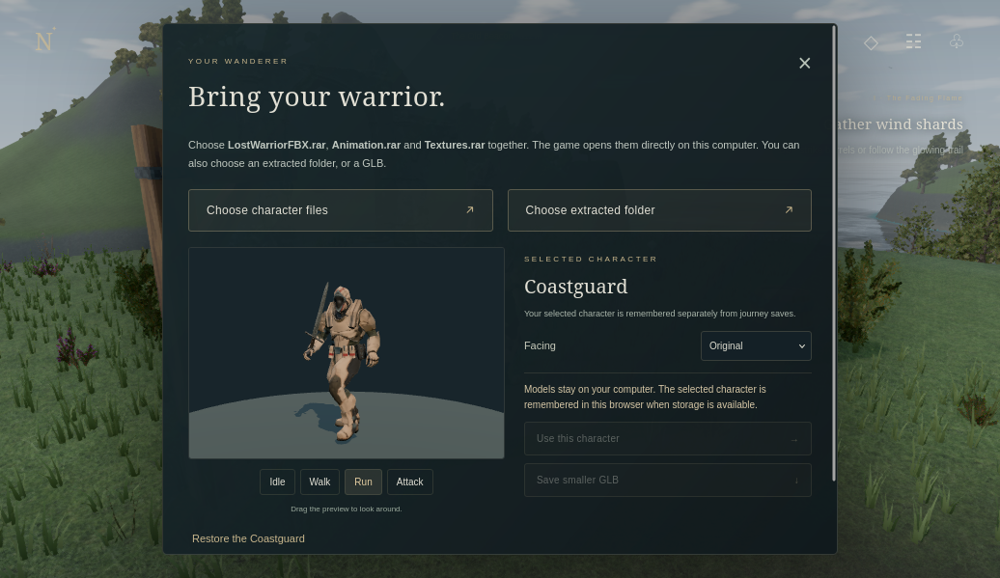

# Northreach IV 4.1 — The Broken Oath

[**Download the complete game (25 MB ZIP)**](https://github.com/BarbaraCodingOS/game/raw/refs/heads/playtest/northreach-v4-download/Northreach-PLAY.zip?download=1&v=4.1)

Extract the ZIP and open **Northreach-PLAY.html** in Brave/Chrome/Firefox. The
playable HTML includes its code, models, textures and styling. The other files
are credits and test reports. No server or Internet connection is required;
JavaScript and WebGL must be enabled.

## Use your Lost Warrior

1. Open **Character** from the title or pause menu.
2. Choose **LostWarriorFBX.rar**, **Animation.rar** and **Textures.rar** together.
3. Check the live preview with **Idle / Walk / Run / Attack**; drag to look around.
4. Click **Use this character**.

An extracted folder or GLB can also be selected. Change **Facing** if necessary.
The model is processed locally and remembered in this browser when storage is
available. **Save smaller GLB** exports a portable copy with textures/animations.
Restoring the Coastguard keeps your journey intact. The original archives still
exceeded the chat tool's 32 MiB transfer cap, so the exact Lost Warrior model is
not preinstalled or claimed to have been inspected here. This local import route
was tested with separate GLB and a textured, multi-mesh FBX RAR larger than 32 MiB.

## Graphics and play

4.1 adds outdoor sky lighting, AgX tone mapping, a soft player contact shadow,
fuller curved grass, ground normal/roughness detail, 152 rounded natural boulders
and uncropped 512px distant trees. The supplied pixel-fantasy art style remains.
The game retains 47 imported environmental models/modules, five working story
chapters, combat/boss encounters, a ferry, loot, checkpoints and browser saves.

WASD moves, drag looks, Shift runs, Space jumps/glides, Q dodges, F/left click
attacks, G is heavy attack, B/right click blocks, E interacts and C heals.
M opens the map, J the journal, I inventory and P/Esc pauses. Settings include
four graphics presets and key rebinding. Choose Low/Medium if performance is poor.

## Verification and limits

29 model tests and nine browser cases passed. Both offline editions passed actual
file-URL startup/gameplay/High-rendering tests. The self-contained HTML also
imported, applied and remembered a textured 35 MB RAR offline. No HTTP/HTTPS
runtime requests or game-page errors occurred. See [validation](docs/validation.md).

The cloud software renderer measured about **1.66 FPS** (Low); the last sampled
game update was **1.1 ms**. This does not establish playable performance or 60 FPS
on your Mac. The environment restarted before profiling, so comparison with V4
is not controlled. Exact Lost Warrior performance/rig compatibility and hardware
GPU frame rates remain unverified. See the [performance report](docs/performance.json)
and [implementation notes](docs/implementation.md).

[Direct HTML](https://github.com/BarbaraCodingOS/game/raw/refs/heads/playtest/northreach-v4-download/Northreach-PLAY.html?download=1&v=4.1)
is served by GitHub as text: use Save link as / Download raw file to save it.
[Folder-edition ZIP](https://github.com/BarbaraCodingOS/game/raw/refs/heads/playtest/northreach-v4-download/Northreach-v4.zip?download=1&v=4.1):
extract everything and open Northreach-v4/START-GAME.html with game.js/game.css beside it.

[Asset provenance](ASSET-CREDITS.txt), kit/decoder licenses and
[download hashes](DOWNLOAD-CHECKSUMS.json) are included. Individual pending-clearance
metadata is preserved; no blanket CC0 is claimed. Imports remain on your computer.

Actual High-setting local-file test frame (default Coastguard, cloud software renderer):

Live Character menu (default Coastguard shown before importing your model):

